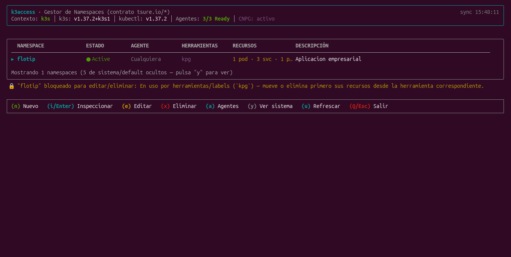
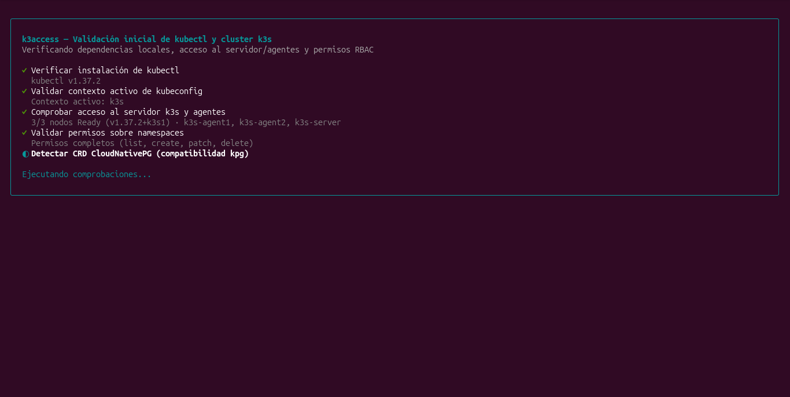
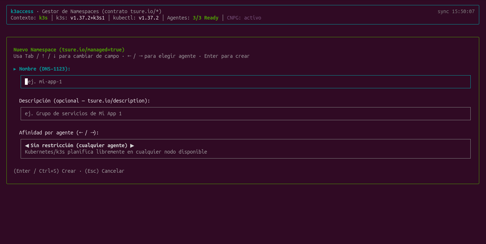
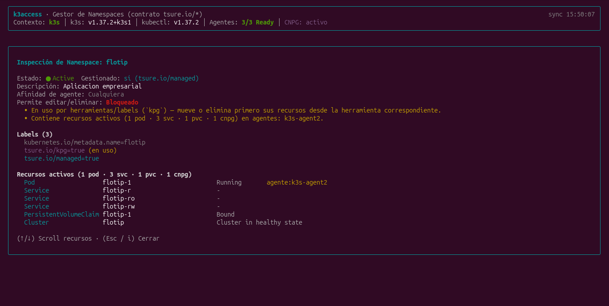
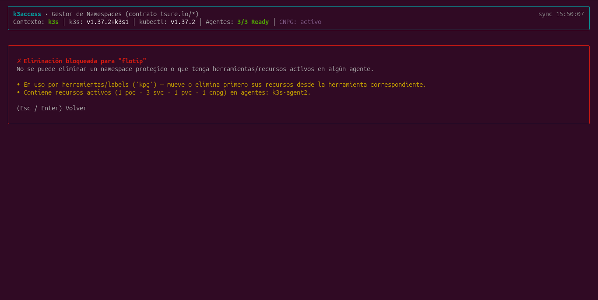
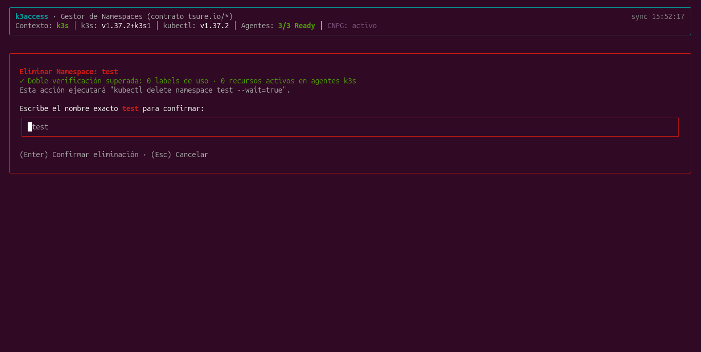
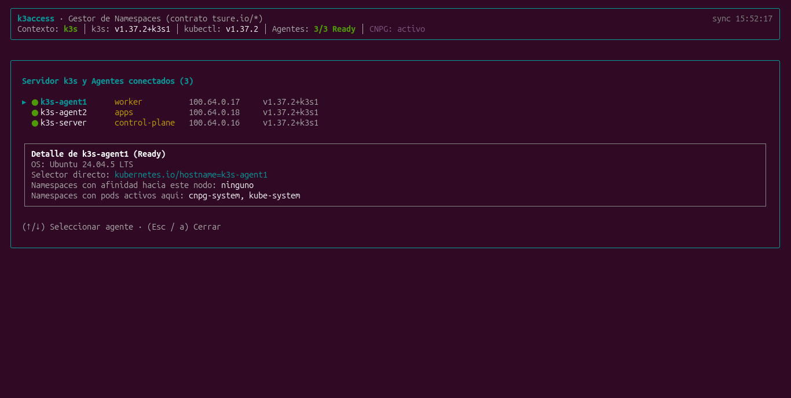

# `k3access` — Gestor TUI de Namespaces para k3s (`tsure.io/*`)


Herramienta interactiva de terminal (**TUI**) que depende únicamente de `kubectl` en tu equipo local. Antes de permitir cualquier operación, valida que `kubectl` esté instalado, que exista acceso real al servidor k3s y sus agentes, y que tengas permisos RBAC suficientes. A partir de ahí, centraliza la administración segura del ciclo de vida de los `Namespace` bajo el contrato compartido **`tsure.io/*`** (compatible con **`kpg`** y futuras herramientas del ecosistema).



---

## Características principales

- **Validación Pre-Flight automática:** comprueba binario `kubectl`, contexto activo, conectividad con el servidor y agentes k3s (`Ready`), permisos RBAC (`list`, `create`, `patch`, `delete`) y disponibilidad del CRD CloudNativePG (`clusters.postgresql.cnpg.io`).
- **Doble candado estricto para editar y eliminar:** un namespace **solo puede editarse `(e)` o eliminarse `(x)`** si no es protegido, tiene **0 labels de uso** (`tsure.io/*` distintos de `tsure.io/managed`) y **0 recursos activos** en cualquier agente k3s.
- **Afinidad por agente (`nodeSelector`):** asigna namespaces a un agente específico (`k3s-agent1`, `k3s-agent2`), a un rol (`rol:apps`, `rol:worker`) o a un selector personalizado `clave=valor`, validando en vivo qué agentes coinciden.
- **Separación estricta de responsabilidades (`tsure.io/*`):** nunca sobrescribe ni borra labels de herramientas externas (como `tsure.io/kpg=true`), salvo mediante el flujo explícito de auditoría cuando hay 0 recursos reales en Kubernetes.
- **Ejecución segura sin shell:** todos los comandos pasan por `child_process.spawn('kubectl', args)` sin shell intermedio para evitar inyección de comandos.
- **Dashboard en vivo:** refresco automático cada 5 segundos en pantalla alterna de terminal, sin ensuciar el historial.
- **Empaquetado standalone opcional:** genera un único binario ejecutable con `esbuild` + `node --build-sea`.

---

## Recorrido visual

### 1. Validación inicial (Pre-Flight)
Al arrancar, `k3access` verifica el entorno local y la salud del cluster antes de abrir el dashboard.



### 2. Dashboard principal en vivo
Muestra cada namespace con su estado, afinidad de agente, herramientas `tsure.io/*` activas, conteo real de recursos y descripción. Los namespaces de sistema y `default` permanecen ocultos por defecto (`y` para alternar).


### 3. Creación de namespace y afinidad por agente `(n)`
Valida el nombre según DNS-1123 en tiempo real, aplica `tsure.io/managed=true`, permite añadir descripción y elegir a qué agente o rol k3s se asocia el namespace.



### 4. Inspección detallada `(i)` / `Enter`
Consulta el estado en vivo del namespace: todos sus labels, herramientas vinculadas, agentes coincidentes con el `nodeSelector` y el listado de recursos activos indicando en qué agente corre cada pod.



### 5. Protección contra edición/eliminación cuando está en uso `(e)` / `(x)`
Si alguna herramienta (`kpg`, etc.) o algún agente k3s mantiene recursos activos dentro del namespace, tanto la edición como la eliminación se bloquean mostrando el motivo exacto.



### 6. Eliminación segura con doble confirmación `(x)`
Cuando el namespace supera la doble verificación (`0 labels de uso` y `0 recursos activos`), solicita escribir su nombre exacto antes de ejecutar `kubectl delete namespace <nombre> --wait=true`.



### 7. Vista del servidor k3s y agentes conectados `(a)`
Lista el control-plane y cada agente conectado con su estado, rol, IP interna, versión de k3s y qué namespaces tienen afinidad o pods corriendo en ese nodo.



---

## Contrato de labels y anotaciones (`tsure.io/*`)

```yaml
apiVersion: v1
kind: Namespace
metadata:
  name: mi-app-1
  labels:
    tsure.io/managed: "true"                            # Aplicado por k3access al crear
    tsure.io/kpg: "true"                                # Gestionado exclusivamente por kpg
  annotations:
    tsure.io/description: "Grupo de servicios de Mi App 1"
    scheduler.alpha.kubernetes.io/node-selector: "kubernetes.io/hostname=k3s-agent2"
    tsure.io/node-selector: "kubernetes.io/hostname=k3s-agent2"
```

### Reglas del contrato
1. **Namespaces protegidos (solo lectura, no editables ni eliminables):** `default`, `kube-system`, `kube-public`, `kube-node-lease` y `cnpg-system`.
2. **Doble candado en edición y eliminación:**
   - **Condición A:** sin labels de uso (`tsure.io/*` distintos de `tsure.io/managed` ni otros labels de uso).
   - **Condición B:** sin recursos activos (`pods`, `deployments`, `statefulsets`, `services`, `pvc` ni `clusters.postgresql.cnpg.io`).
3. **Auditoría de labels huérfanos:** únicamente si Condición B = 0 recursos reales pero quedó un label `tsure.io/<tool>` atascado, la vista `(x)` ofrece un paso manual confirmado (`LIMPIAR`) para retirarlo.

> **Nota sobre afinidad por agente en k3s:** `k3access` guarda tanto `scheduler.alpha.kubernetes.io/node-selector` como `tsure.io/node-selector`. Para que el API server de k3s aplique automáticamente `scheduler.alpha.kubernetes.io/node-selector` a los pods nuevos, habilita el plugin de admisión `PodNodeSelector` en `k3s-server` (`--kube-apiserver-arg=enable-admission-plugins=...,PodNodeSelector`).

---

## Requisitos

- **`kubectl`** instalado en el `PATH` del equipo local.
- Archivo `~/.kube/config` (o variable `KUBECONFIG`) apuntando a tu cluster k3s con permisos sobre `namespaces` y lectura de nodos/recursos.
- **Node.js v20+** (para ejecutar desde fuente o compilar).

---

## Instalación y uso

```bash
# 1. Instalar dependencias
npm install

# 2. Ejecutar en modo desarrollo (TUI interactiva)
npm run dev

# 3. Compilar TypeScript y ejecutar versión compilada
npm run build
npm start

# 4. Verificación rápida no interactiva (Pre-Flight + resumen de namespaces)
node dist/index.js --check
```

### Pruebas y empaquetado standalone

```bash
# Chequeo estricto de tipos TypeScript
npm run typecheck

# Ejecutar pruebas unitarias (DNS-1123, contrato tsure.io/*, afinidad y doble candado)
npm test

# Generar binario standalone en build/k3access (esbuild + node --build-sea)
npm run build:sea
```

---

## Atajos de teclado

| Tecla | Acción |
| :--- | :--- |
| `↑` / `↓` | Navegar por la lista de namespaces |
| `n` | Crear nuevo namespace (nombre DNS-1123, descripción y afinidad por agente) |
| `i` / `Enter` | Inspeccionar labels, afinidad, herramientas y recursos activos |
| `e` | Editar descripción y afinidad de agente *(bloqueado si está en uso o protegido)* |
| `x` | Eliminar namespace con doble candado *(y auditoría si solo hay labels huérfanos)* |
| `a` | Ver estado del servidor k3s y agentes conectados |
| `y` | Mostrar / ocultar namespaces protegidos (`default` y sistema) |
| `u` | Refrescar manualmente (además del refresco automático cada 5s) |
| `Q` / `Esc` | Salir y restaurar la terminal |

---

## Estructura del proyecto

```text
k3access/
├── images/                        # Capturas de pantalla referenciadas en este README
├── scripts/
│   └── build-sea.mjs              # Empaquetado binario standalone (esbuild + node --build-sea)
├── src/
│   ├── index.tsx                  # Pantalla alterna + modo --check + render(<App />)
│   ├── App.tsx                    # Flujo PreFlight -> Dashboard y refresco cada 5s
│   ├── types/k8s.ts               # Tipos de namespaces, agentes, recursos y PreFlight
│   ├── utils/validation.ts        # DNS-1123, contrato tsure.io/*, nodeSelector y doble candado
│   ├── services/
│   │   ├── kubectl.ts             # Wrapper spawn('kubectl', args) sin shell
│   │   ├── preflight.ts           # Validación de kubectl, contexto, nodos, RBAC y CNPG
│   │   ├── nodes.ts               # Consulta de servidor/agentes k3s y presets de afinidad
│   │   └── namespaces.ts          # CRUD namespaces, doble verificación en vivo y auditoría
│   └── components/                # PreFlight, Header, Dashboard, FooterBar y modales
└── tests/
    └── namespaces.test.ts         # Pruebas unitarias con node:test
```

---

## Checklist de integración con `kpg`

1. Crea `mi-app-1` con `(n)` en `k3access` → aparece como **Libre**.
2. Crea una base de datos en `mi-app-1` desde **`kpg`** → `kpg` añade `tsure.io/kpg=true`.
3. Vuelve a `k3access` → `mi-app-1` muestra **`kpg`** y bloquea edición `(e)` y eliminación `(x)`.
4. Mueve o elimina la BD desde **`kpg`** → `kpg` retira `tsure.io/kpg`.
5. En `k3access`, `mi-app-1` vuelve a estar **Libre** y ya permite editarlo o eliminarlo de forma segura.
